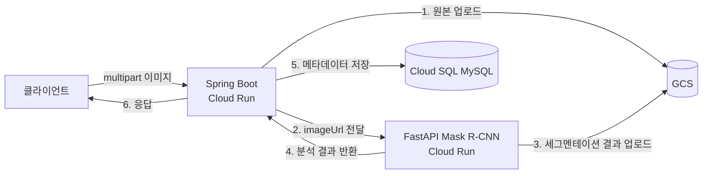

# Gyeol-Server 백엔드 성능 개선 리포트

이미지 분석 API의 병목을 계측으로 찾아내고, 개선한 뒤 동일 조건에서 재측정한 기록.

**핵심 결과 — `POST /api/images/analyze`, 50 VU(Virtual User) 5분 지속 부하**

| 지표 | 개선 전 | 개선 후 | 변화 |
|---|---|---|---|
| 처리량 | 16.97 RPS | **23.85 RPS** | **+40.5%** |
| 응답시간 중앙값 | 2.62 s | **1.75 s** | **−33.2%** |
| 응답시간 평균 | 2.58 s | **1.83 s** | −29.1% |
| p95(전체 요청의 95%) | 3.15 s | 3.09 s | −1.9% |
| 최대 응답시간 | 7.25 s | **5.20 s** | −28.3% |
| DB 저장 구간 | 102 ms | **9 ms** | **−91.2%** |
| ML 커넥션 대기 | 평균 26.6건 | **0건** | 해소 |
| 에러율 | 0.00% | 0.00% | — |

**고부하 — 최대 200 VU 스트레스 테스트**

| 지표 | 개선 전 | 개선 후 | 변화 |
|---|---|---|---|
| 처리량 | 18.27 RPS | **24.97 RPS** | **+36.7%** |
| p95 | 10.76 s | **7.99 s** | −25.7% |
| ML 커넥션 대기 | 최대 **183건** | **0건** | 해소 |

---

## 1. 시스템 구조



요청 하나가 **GCS 업로드 → ML 추론 → DB 저장**을 순차로 거친다.
ML 은 업로드된 이미지의 URL 을 받아야 하므로 1·2 단계는 병렬화할 수 없다.
이 구조 때문에 요청당 응답시간이 길고, 그동안 서블릿 스레드가 계속 묶인다.

## 2. 측정 환경

외부 의존성을 상수로 고정해야 "백엔드 코드를 고쳐서 얼마나 좋아졌는가"가 분리된다.

| 구성요소 | 로컬 측정 환경 | 고정 이유 |
|---|---|---|
| ML 서버 | WireMock, 고정 지연 **800 ms** | 추론 시간이 변동하면 백엔드 개선분이 묻힌다 |
| GCS | fake-gcs-server 에뮬레이터 | 인터넷 왕복 지연 제거 + 실버킷 오염 방지 |
| DB | MySQL 8 (Docker) | Cloud SQL 네트워크 변동 제거 |
| 부하 도구 | k6 v2.1.0 | |
| 애플리케이션 | Spring Boot 3.0.0 / Java 17 | |
| 하드웨어 | Apple Silicon 8코어, 부하 생성기와 서버가 같은 머신 | |

- 시나리오: `load-test/02-load-analyze.js` — 0→50 VU 램프업 1분, **50 VU 5분 유지**, 램프다운 30초
- 이미지: 145 KB JPEG 고정
- 각 실행 전 워밍업 5회로 JIT·커넥션 수립 비용 제외
- 부하 중 10초 간격으로 병목 메트릭 샘플링 (`*.bottleneck.txt`)

재현 절차는 [load-test/README.md](../load-test/README.md) 참고.

## 3. 계측 붙이기

측정 전 이 프로젝트에는 **성능 계측이 전혀 없었다.** 먼저 관측 수단부터 만들었다.

- `spring-boot-starter-actuator` + `micrometer-registry-prometheus` 추가
- `server.tomcat.mbeanregistry.enabled: true` — 이게 없으면 Tomcat 스레드 메트릭이 안 나온다
- `percentiles-histogram` 활성화 — 없으면 Prometheus 에서 p95/p99 를 못 뽑는다
- Reactor Netty 커넥션 풀에 `.metrics(true)` — **이걸 켜기 전에는 가장 중요한 병목이 아예 보이지 않았다**
- 구간별 커스텀 타이머: `gcs.upload`, `ml.segmentation`, `segmentation.persist`
  → 전체 응답시간 중 어디가 느린지 분해할 수 있어야 개선 기여도를 말할 수 있다
- Prometheus + Grafana 대시보드 (`monitoring/`)

## 4. 병목 분석

### 4.1 가설 검증 결과

측정 전에 코드를 읽고 7개 가설을 세운 뒤, 계측으로 검증했다.
**절반 이상이 틀렸다.** 추측만으로 고쳤다면 엉뚱한 곳을 손댔을 것이다.

| # | 가설 | 판정 | 근거 |
|---|---|---|---|
| B1 | Tomcat 스레드 포화 | ⚠️ 조건부 | 50 VU 에선 여유(47/200)지만 **200 VU 에선 완전 포화**(6.2) |
| B2 | WebClient 커넥션 풀 부족 | ✅ **확인** | active 15.3 / **max 16**, 평균 **26.6건 대기** |
| B3 | HikariCP 커넥션 부족 | △ 부분 | baseline 에선 무관(2.3/10). B2 해소 후 드러남 |
| B4 | `@Transactional` + `Mono` 오조합 | ✅ 확인 | 코드 검토로 확인 (정합성 문제) |
| B5 | ML 서버 자체 한계 | — | 측정 범위 밖(스텁으로 고정) |
| B6 | 힙 부족 / GC 압박 | ❌ 기각 | GC pause 미미, 힙 여유 |
| B7 | 마이페이지 N+1 / 인덱스 부재 | ❌ 기각 | 이미 `JOIN FETCH` 적용, MySQL 이 FK 인덱스 자동 생성 |

추가로 측정 중 **가설에 없던 병목 2개**를 발견했다 (4.3, 4.4).

### 4.2 B2 — ML 호출 커넥션 풀 (주 병목)

Reactor Netty 의 기본 커넥션 풀은 `max(코어수, 8) × 2` 다.
8코어 머신에서 **16개**. 그런데 동시 요청은 50개였다.

```
Netty active  평균 15.3 / max 16    ← 96% 포화
Netty pending 평균 26.6 / 최대 34   ← 26개가 커넥션을 못 얻고 대기
Tomcat busy   평균 47.0 / max 200   ← 스레드는 놀고 있음
```

ML 스텁의 고정 지연은 **800 ms** 인데 실제 응답시간 중앙값은 **2.62 s** 였다.
차이 **1.8초가 전부 커넥션 대기 큐에서 흘러간 시간**이다.

원인이 중요하다. 이 풀 크기는 **CPU 코어 수를 기준으로 정해진다.** 하지만 ML 호출은
CPU 를 쓰지 않고 대부분 응답을 기다리는 시간이다. 코어 수와 아무 상관이 없다.
기본값이 이 워크로드에 맞지 않았던 것이다.

### 4.3 GCS 업로드가 매번 왕복 2회 (측정 중 발견)

B2 를 고치고 나니 처리량이 22.3 RPS 에서 더 오르지 않았다. 구간 분해를 보니:

```
GCS 업로드  901 ms   ← ML 보다 느리다
ML 호출     861 ms
DB 저장     102 ms
```

145 KB 파일 업로드가 901 ms 나 걸릴 이유가 없다. 에뮬레이터 접근 로그를 보니:

```
POST /upload/...?uploadType=resumable   ← 세션 생성
PUT  /upload/...?uploadType=resumable   ← 데이터 전송
```

`storage.createFrom(blobInfo, inputStream)` 은 **스트림의 크기를 모르기 때문에 항상
resumable 업로드**를 쓴다. 수백 KB 짜리 이미지 하나에도 네트워크 왕복이 2번 든다.
`MultipartFile` 은 크기를 이미 알고 있는데도 그 정보를 버리고 있었다.

이건 에뮬레이터만의 문제가 아니라 **실제 GCS 에도 그대로 적용되는 낭비**다.

### 4.4 블로킹 JPA 저장이 Netty 이벤트 루프에서 실행 (코드 검토로 발견)

```java
.flatMap(responseDto -> {
    ...
    segmentedImageRepository.save(segmentedImage);  // 블로킹 JDBC
    return Mono.just(responseDto);
})
```

`flatMap` 안은 **Netty 이벤트 루프 스레드**다. 여기서 블로킹 JDBC 를 호출하면
DB I/O 가 끝날 때까지 이벤트 루프가 멈추고, **그 루프가 담당하는 다른 요청들의
응답 처리까지 같이 막힌다.** 이벤트 루프 스레드는 코어 수만큼(8개)밖에 없으므로
영향 범위가 넓다.

### 4.5 `@Transactional` 이 아무 일도 하지 않고 있었음

```java
@Transactional
public Mono<SegmentationResponseDTO> requestSegmentation(...) {
    return webClient.post()... // Mono 를 "조립해서" 즉시 반환
}
```

이 메서드는 Mono 를 만들어 즉시 반환한다. 트랜잭션은 그 반환 시점에 열렸다가
**곧바로 커밋**된다. 정작 DB 저장은 한참 뒤 구독 시점에 다른 스레드에서 일어나므로
**그 트랜잭션 밖**이다. 커넥션을 한 번 잡았다 놓는 비용만 내고 효과는 0 이었다.

## 5. 개선 내역

### 5.1 ML 커넥션 풀 명시 (B2)

`WebClientConfig` 에서 커넥션 풀을 설정 가능하게 만들고, 기본값을 100 으로 올렸다.
동시에 `.metrics(true)` 를 켜서 포화 여부를 관측 가능하게 했다.

```java
ConnectionProvider.builder("ml")
        .maxConnections(resolvedMax)          // 16 -> 100
        .pendingAcquireMaxCount(...)
        .pendingAcquireTimeout(...)
        .metrics(true)                        // 이게 없으면 병목이 안 보인다
        .build();
```

기준은 코어 수가 아니라 **동시에 처리하려는 요청 수**여야 한다.
Tomcat 스레드 수보다 작으면 그 차이가 그대로 큐 대기가 된다.

### 5.2 작은 파일은 단일 요청 업로드 (4.3)

```java
long size = multipartFile.getSize();
if (size > 0 && size <= SINGLE_SHOT_UPLOAD_LIMIT_BYTES) {  // 2MB
    storage.create(blobInfo, multipartFile.getBytes());     // 왕복 1회
} else {
    try (InputStream in = multipartFile.getInputStream()) { // 큰 파일은 스트리밍 유지
        storage.createFrom(blobInfo, in);
    }
}
```

임계값을 둔 이유: 단일 요청 업로드는 본문을 힙에 통째로 올린다.
`동시 요청 수 × 파일 크기`가 힙에 들어가야 하므로 무제한으로 적용하면 안 된다.
멀티파트 제한이 10MB 이므로 2MB 로 잡았다.

적용 후 접근 로그가 `uploadType=multipart` 단일 POST 로 바뀌었다.

### 5.3 블로킹 DB 저장을 이벤트 루프 밖으로 + 트랜잭션 경계 정리 (4.4, 4.5)

저장 책임을 `SegmentedImageWriter` 로 분리했다.
`@Transactional` 은 프록시 기반이라 같은 클래스 안에서 호출하면 적용되지 않으므로,
**별도 빈이어야** 실제로 트랜잭션이 걸린다.

```java
return Mono.fromCallable(() -> segmentedImageWriter.save(originalImage, responseDto))
        .subscribeOn(Schedulers.boundedElastic())   // 이벤트 루프 밖으로
        .thenReturn(responseDto);
```

그리고 효과가 없던 `requestSegmentation` 의 `@Transactional` 은 제거했다.

### 5.4 HikariCP 커넥션 풀 (B3)

B2 를 해소하자 요청이 DB 까지 더 빨리 도달하면서 커넥션 대기가 나타났다
(pending 최대 5, DB 저장 평균 102 ms). 기본값 10 → 30 으로 올렸다.

```yaml
hikari:
  maximum-pool-size: ${DB_POOL_SIZE:30}
  minimum-idle: ${DB_POOL_MIN_IDLE:10}
  connection-timeout: 10000
  leak-detection-threshold: 20000
```

무작정 키우면 DB 의 `max_connections` 를 넘기므로 인스턴스 한도를 보고 정해야 한다.

## 6. 단계별 측정 결과

개선을 하나씩 적용하며 측정해 **어느 변경이 얼마나 기여했는지** 분해했다.

| 단계 | 처리량 | 중앙값 | DB 저장 | Netty 대기 | Hikari 대기 |
|---|---|---|---|---|---|
| baseline | 16.97 RPS | 2.62 s | 102 ms | **26.6건** | 0 |
| \+ 커넥션 풀 (5.1) | 22.29 RPS | 1.86 s | 102 ms | 0 | 최대 5 |
| \+ 업로드·DB·트랜잭션 (5.2–5.4) | **23.85 RPS** | **1.75 s** | **9 ms** | 0 | 0 |

구간 분해 변화:

| 구간 | baseline 이후(after-b2) | 최종 |
|---|---|---|
| GCS 업로드 | 901 ms | 816 ms |
| ML 호출 | 861 ms | 817 ms |
| DB 저장 | 102 ms | **9 ms** |

**커넥션 풀 하나가 전체 개선의 약 77%를 차지했다.** 설정 한 줄이지만,
계측 없이는 찾을 수 없는 한 줄이었다.

### 6.1 고부하 구간 (스트레스 테스트)

`03-stress-analyze.js` — 25 → 50 → 100 → 200 VU 계단식, 총 13분.

| 지표 | 개선 전 | 개선 후 | 변화 |
|---|---|---|---|
| 처리량 | 18.27 RPS | **24.97 RPS** | **+36.7%** |
| 중앙값 | 3.62 s | **2.58 s** | −28.7% |
| p90 | 10.28 s | **7.10 s** | −30.9% |
| p95 | 10.76 s | **7.99 s** | −25.7% |
| p99 | 11.17 s | 12.62 s | +13.0% |
| 최대 | 12.71 s | 20.08 s | +58.0% |
| ML 커넥션 대기 | 평균 65.1 / **최대 183건** | **0건** | 해소 |
| 에러율 | 0.00% | 0.005% (1건) | — |

개선 전에는 200 VU 구간에서 **183개 요청이 동시에 커넥션을 기다렸다.**
중앙값·p90·p95 는 모두 크게 개선됐다.

다만 **p99 와 최댓값은 오히려 나빠졌다.** 원인은 개선 전 커넥션 풀이 사실상
**유입 제한(throttle) 역할**을 하고 있었기 때문이다. 대기 큐가 요청을 붙잡아두는 동안
뒤쪽 구간이 보호돼 꼬리가 짧아 보였다. 풀을 열어주자 요청이 전부 통과하면서
다음 구간(GCS·Tomcat 스레드)에서 경합이 생겼고, 그 결과가 꼬리에 나타났다.
**처리량과 중앙값을 얻는 대신 최악 지연을 일부 내준 트레이드오프**이며,
꼬리를 잡으려면 6.2 의 구조적 개선이 필요하다.

### 6.2 200 VU 에서는 B1(Tomcat 스레드)이 진짜 병목이 된다

50 VU 에서 기각했던 B1 이 고부하에서는 성립했다.

```
Tomcat busy   평균 90.3 / 최대 200 (max 200)   ← 완전 포화
Netty active  평균 23.9 / max 100              ← 여유
Hikari active 평균 4.2 / max 30                ← 여유
```

커넥션 풀을 아무리 키워도 처리량이 25 RPS 근처에서 더 오르지 않는 이유가 여기 있다.
요청 하나가 `GCS 업로드(816ms) + ML(817ms)` 동안 **서블릿 스레드를 계속 붙잡는다.**
스레드 200개가 전부 외부 I/O 대기로 묶이면 그 이상은 받을 수 없다.

`server.tomcat.threads.max` 를 올리는 건 미봉책이다. 스레드는 메모리를 먹고,
컨텍스트 스위칭 비용도 는다. **근본 해법은 `.block()` 을 걷어내 요청 처리를
논블로킹으로 바꾸거나, 분석을 비동기 작업으로 분리하는 것**이다 (7장 후속 과제).

## 7. 실환경 모니터링 (GCP)

로컬 스택은 병목을 분리하기 위한 실험 환경이고, 실제 서비스는 Cloud Run 위에서 돈다.
운영 지표는 Cloud Monitoring 대시보드로 본다.

대시보드 정의: [`monitoring/gcp/cloud-run-dashboard.json`](../monitoring/gcp/cloud-run-dashboard.json)

```bash
gcloud monitoring dashboards create \
  --config-from-file=monitoring/gcp/cloud-run-dashboard.json
```

| 패널 | 보는 것 |
|---|---|
| 요청 수 / 응답 코드별 요청 | 트래픽과 에러율 |
| 지연시간 p50·p95·p99 | 로컬에서 개선한 지표가 실환경에도 반영됐는지 |
| 인스턴스 수 (state별) | 오토스케일 동작, `--max-instances 10` 상한 도달 여부 |
| 컨테이너 CPU / 메모리 사용률 | `--cpu 1 --memory 1Gi` 가 적정한지 |
| 컨테이너 시작 지연 | 콜드스타트가 사용자 지연에 얼마나 기여하는지 |

로컬과 실환경을 나눠 보는 이유:

- **로컬 Prometheus/Grafana** — 애플리케이션 내부 지표(스레드, 커넥션 풀, 구간별 소요시간).
  Cloud Run 에서는 얻기 어렵고, 개선 근거를 만드는 데 필요한 건 이쪽이다.
- **Cloud Monitoring** — 인프라 지표(인스턴스 수, 콜드스타트, 컨테이너 자원).
  애플리케이션 계측만으로는 볼 수 없다.

두 축이 모두 있어야 "코드가 좋아졌는데 왜 사용자 체감은 그대로인가" 같은 질문에
답할 수 있다(예: 콜드스타트가 원인인 경우).

## 8. 한계와 남은 과제

정직하게 적어둔다.

- **GCS 에뮬레이터가 새로운 바닥이 됐다.** 최종 상태에서 업로드가 여전히 816 ms 다.
  145 KB 업로드가 이만큼 걸릴 이유는 없고, 50 동시 요청에서 에뮬레이터가 직렬화되는
  것으로 보인다. 즉 **측정된 40.5% 는 보수적인 수치**이고, 병렬 처리가 제대로 되는
  실제 GCS 에서는 개선 폭이 더 클 가능성이 높다. 다만 이는 검증 전 추정이다.
- **부하 생성기와 서버가 같은 머신**이라 CPU 를 경합한다. 절대 수치보다
  before/after 상대 비교에 의미를 두어야 한다.
- **p95 는 거의 개선되지 않았다** (3.15 s → 3.09 s). 중앙값과 처리량은 크게 나아졌지만
  꼬리 지연은 그대로다. 위 GCS 직렬화가 유력한 원인이며, 별도 규명이 필요하다.
- **실환경(Cloud Run) 검증 미완료.** 로컬 개선이 Cloud Run + Cloud SQL + 실제 GCS 에서도
  재현되는지 확인해야 결론이 완성된다.
- **ML 서버가 진짜 상한.** 백엔드를 아무리 고쳐도 추론이 800 ms 면 사용자 체감은 크게
  달라지지 않는다. 근본 개선은 ML 쪽이며, 백엔드에서는 비동기 처리(요청 접수 후
  결과 폴링/푸시)로 사용자 대기를 없애는 방향이 유효하다.

### 후속 과제

| 과제 | 기대 효과 |
|---|---|
| 분석 요청을 비동기화 (작업 큐 + 상태 조회) | 서블릿 스레드 점유 제거, 사용자 체감 대기 소멸 |
| ML 서버 GPU 인스턴스 / 배치 추론 | 800 ms 상한 자체를 낮춤 |
| Cloud Run `--concurrency`, `--cpu` 튜닝 | 인스턴스당 처리량 |
| 동일 이미지 재분석 캐싱 | 중복 추론 제거 |
| `@Async` 로 GCS 업로드와 메타데이터 저장 병렬화 | 요청당 수십 ms |

## 9. 측정 과정에서 배운 것

- **`.metrics(true)` 를 켜기 전에는 주 병목이 대시보드에 아예 없었다.**
  계측되지 않는 것은 개선할 수 없다.
- **프레임워크 기본값을 의심해야 한다.** Reactor Netty 의 `코어수 × 2` 는 CPU 바운드
  작업에는 합리적이지만, 외부 API 를 기다리는 워크로드에는 맞지 않는다.
- **가설의 절반 이상이 틀렸다.** Tomcat 스레드와 N+1 을 의심했지만 둘 다 아니었고,
  정작 주 병목은 가설 목록의 2번이었으며, 큰 문제 두 개는 가설에 아예 없었다.
- **부하 테스트 환경 자체가 결과를 오염시킬 수 있다.** 이번에도 에뮬레이터 OOM,
  디스크 포화로 인한 테스트 이미지 손상, 900 MB 로그 등으로 세 번을 다시 측정했다.
  실행 조건을 결과와 함께 기록(`*.env.txt`)해두지 않았다면 잘못된 수치를 믿었을 것이다.

---

## 부록: 재현 방법

```bash
docker compose up -d
./load-test/restart-app.sh
./load-test/seed-users.sh 50
./load-test/set-mock-delay.sh 800
./load-test/run.sh 02-load-analyze my-run
```

개선 전 상태로 되돌려 비교하려면:

```bash
ML_MAX_CONNECTIONS=16 DB_POOL_SIZE=10 ./load-test/restart-app.sh
```

원본 측정 결과는 `load-test/results/{baseline,after-b2,after-all}/` 에 있다.
